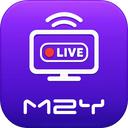
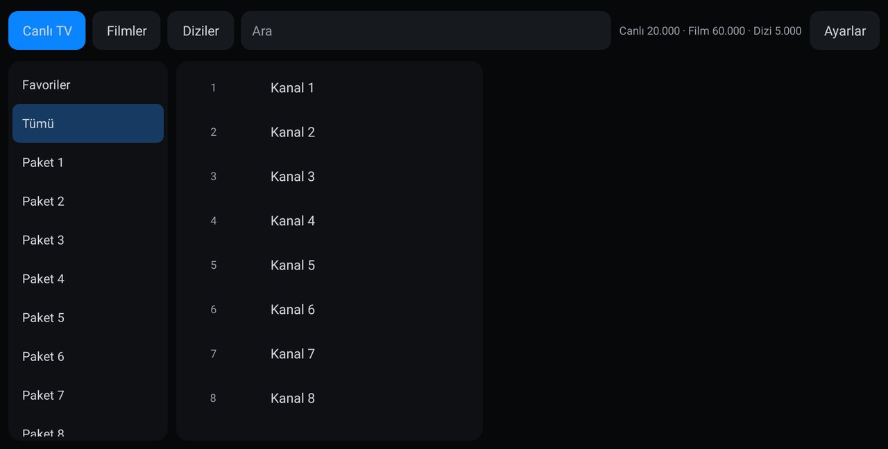

<p align="center"></p>
<h1 align="center">M2Y TV</h1>
<p align="center"><b>A lightweight IPTV player built for the BYD multimedia screen</b><br><sub>BYD multimedya ekranı için hafif IPTV oynatıcı · Лёгкий IPTV-плеер для мультимедийного экрана BYD</sub></p>
<p align="center">
  <a href="https://github.com/mehmetmesut/byd-m2y-tv/releases/latest"></a>
  <a href="https://github.com/mehmetmesut/byd-m2y-tv/releases"></a>
  
  
  
  
</p>
<p align="center">
  <a href="https://github.com/mehmetmesut/byd-m2y-tv/releases/download/1.25.07.68.0/M2YTV_1.25.07.68.0.apk"><b>⬇ Download APK (1.7 MB)</b></a> ·
  <a href="https://byd.mehmetmesut.com">byd.mehmetmesut.com</a> ·
  <a href="https://github.com/mehmetmesut/byd-m2y">⭐ All M2Y apps for BYD</a>
</p>
<p align="center"></p>

<details open>
<summary><b>🇬🇧 English</b></summary>

### Why this app

I built M2Y TV first for **my own BYD SEAL U DM-i**. The IPTV players in the stores are made for TV boxes and phones: they carry ads, Google Play dependencies or analytics, and they slow down with the large lists real providers send (tens of thousands of channels, films and series). M2Y TV is written from scratch for one screen and one car, then shared free with every BYD owner: no ads, no tracking, and as little CPU, RAM and storage as possible.

### Highlights

- **Tiny and fast:** a 1.7 MB APK, one activity, one hardware decoder at a time, a channel switch reuses the same player.
- **Huge lists, no lag:** provider lists with 20,000 live channels, 60,000 films and 5,000 series (the test catalogue) are streamed into SQLite and shown page by page.
- **Both common sources:** M3U / M3U8 playlist by URL and Xtream Codes login, several playlists, one selected at a time.
- **Made for touch in a car:** 56 dp touch targets, preview box plus full screen, previous/next channel, −10 s / +30 s.
- **Private by design:** playlist addresses and logins are sealed with an Android Keystore key and masked in logs; no ads, no analytics, no Google services.
- **Never hangs:** a stalled stream gives up within about 30 s with a tap-to-retry message instead of freezing the screen.

### Features

- **Sources:** M3U / M3U8 playlists by URL and **Xtream Codes** logins (server, user name, password); several playlists stored, one selected at a time; refresh on demand. An optional XMLTV (EPG) address can be added to each playlist.
- **Content:** **Live TV, Movies and Series** in separate tabs, each with categories. Entries of a plain M3U list are sorted into live, films and series from their address (`/movie/`, `/series/`, `.mkv`, `.mp4`, `.avi`).
- **Favourites:** long-press an item to add or remove it; a Favourites category per tab.
- **Search:** Turkish-aware, so "Şok" finds "sok" and "İzmir" finds "izmir".
- **EPG:** XMLTV guide (from the playlist header, an address you typed, or Xtream) shows the current and next programme.
- **Playback:** preview box and full screen, previous/next channel, −10 s / +30 s, and playback speed for films and episodes (1× → 1.25× → 1.5× → 0.5× → 0.75×; live is always 1×). HLS and progressive streams, hardware decoder first with a software fallback, `User-Agent` and `Referer` options from `#EXTVLCOPT` lines are honoured.
- **Resilience:** a stalled or dropped stream is retried with backoff and gives up within about 30 s with a tap-to-retry message; a film resumes at its position when you return to the app.
- **Safe refresh:** a list is downloaded in the background and published only when complete, so the previous catalogue stays usable while it updates; one missing section (some Xtream panels have no series) does not lose the others.
- **Interface language:** Turkish.

### Built for the head unit

| Head unit fact | Design decision |
|---|---|
| Android 10 (API 29), arm64, no Google services | Media3 ExoPlayer + OkHttp only; no Google, Firebase, billing, ads or tracking; R8-shrunk APK of 1.7 MB |
| Qualcomm SM6125, 8 GB RAM, 1920×1080 at 240 dpi | Single-activity Views UI (no heavy UI framework), recycled lists, 56 dp touch targets, video and audio renderers only; ExoPlayer buffer capped at 32 MB |
| Provider lists with tens of thousands of items | Streaming parsers into platform SQLite with batched inserts; paging (500 items) so 60,000 films scroll without loading them all |
| One hardware decoder, 256 MB Java heap limit | One player reused for every channel; the preview stops when you leave its tab; memory measured at 33–43 MB on the emulator |
| Shared car, saved logins | Playlist addresses and Xtream logins sealed with an Android Keystore key (AES-256-GCM) and masked in logs |
| Spotty mobile data while driving | Retry with backoff, bounded give-up time, tap to retry |

### Install

With wireless ADB enabled on the head unit:

```
adb connect <car-ip>:5555
adb install -r M2YTV_1.25.07.68.0.apk
```

Windows one-click installer: [m2y-kurulum.cmd](https://byd.mehmetmesut.com/m2y-kurulum.cmd) asks for the car's IP, downloads Google's platform-tools if missing, downloads the apps you choose, verifies their SHA-256 sums and installs them.

Direct install from the car's browser only works on head units whose **stock BYD package installer has been unlocked** (the stock one blocks third-party APKs with a "driving safety" notice); this project does not distribute BYD files. After installing, the SealNav / stock launcher may need a restart to show the new icon.

All M2Y APKs are signed with the same M2Y key, so updates install over the previous version and keep your settings.

**First run:** open M2Y TV, open **Ayarlar** (Settings) and press **+ M3U ekle** or **+ Xtream ekle**, fill in the address (or server, user name and password) and save. **You need your own IPTV subscription; M2Y TV ships no channels.**

### Privacy & permissions

| Permission | Why |
|---|---|
| `INTERNET` | Download your playlist, guide and logos, and play the streams. The app talks only to the addresses you enter or that your playlist contains. |
| `ACCESS_NETWORK_STATE` | Retry playback when the connection returns. |

Nothing else is requested (the `WAKE_LOCK` permission merged from a library is removed). M2Y TV has no account, no analytics, no ads and no crash reporting; backups are disabled. Playlist addresses and logins stay on the head unit, sealed with the Android Keystore, and are masked in logs. Because many IPTV servers only offer plain `http`, cleartext traffic is allowed.

### Compatibility

Designed and tested on the BYD SEAL U DM-i (DiLink 3.0). Other BYD models with an Android 10+ arm64 multimedia screen are expected to work but are not tested.

### Build from source

```
./gradlew test assembleRelease
```

JDK 21 and the Android SDK are required (Kotlin, Android Views, AndroidX Media3 ExoPlayer, OkHttp, platform SQLite, R8). Release signing reads a properties file outside the repository, pointed to by `m2y.signingProps` in `local.properties`. `tools/mock_iptv.py` serves a local test provider (Xtream API, M3U, XMLTV, HLS, MP4) for emulator tests.

### Closing words

I made M2Y TV for my own BYD SEAL U DM-i because the store players did not fit the car: ads, Google Play dependencies, TV-box layouts and a heavy load on the CPU. Then I made it installable and usable on BYD multimedia screens (DiLink) and share it free, without ads and without tracking, built with care to use as little of the head unit's CPU, RAM and storage as possible, to open fast, to answer touch without delay and to stay stable. If it makes your drives better, a ⭐ on the [hub repository](https://github.com/mehmetmesut/byd-m2y) is the nicest thank-you.

**Yeşil Dönüşüm Mühendisi - M2Y**

</details>

<details>
<summary><b>🇹🇷 Türkçe</b></summary>

### Neden bu uygulama

M2Y TV'yi önce **kendi BYD SEAL U DM-i aracım** için yazdım. Mağazalardaki IPTV oynatıcıları TV kutuları ve telefonlar için yapılmış: reklam, Google Play bağımlılığı ya da analiz kodu taşıyorlar ve gerçek sağlayıcıların gönderdiği büyük listelerde (on binlerce kanal, film ve dizi) yavaşlıyorlar. M2Y TV tek bir ekran ve tek bir araç için sıfırdan yazıldı, sonra tüm BYD sahiplerine ücretsiz sunuldu: reklam yok, izleme yok, işlemci, bellek ve depolama kullanımı mümkün olduğunca az.

### Öne çıkanlar

- **Küçük ve hızlı:** 1,7 MB'lık APK, tek etkinlik, aynı anda tek donanım çözücü; kanal değişiminde aynı oynatıcı yeniden kullanılır.
- **Dev listeler, takılma yok:** 20.000 canlı kanal, 60.000 film ve 5.000 dizilik sağlayıcı listeleri (test kataloğu) SQLite'a akışla yazılır ve sayfa sayfa gösterilir.
- **İki yaygın kaynak:** adresle M3U / M3U8 listesi ve Xtream Codes girişi; birden çok liste, her seferinde biri seçili.
- **Araçta dokunmaya uygun:** 56 dp dokunma alanları, önizleme kutusu ve tam ekran, önceki/sonraki kanal, −10 sn / +30 sn.
- **Tasarımdan gizli:** liste adresleri ve girişler Android Keystore anahtarıyla şifreli saklanır, günlüklerde maskelenir; reklam, analiz ve Google hizmeti yok.
- **Donmaz:** takılan yayın yaklaşık 30 sn içinde vazgeçer ve ekranı dondurmak yerine "yeniden denemek için dokunun" mesajı gösterir.

### Özellikler

- **Kaynaklar:** adresle M3U / M3U8 listeleri ve **Xtream Codes** girişi (sunucu, kullanıcı adı, şifre); birden çok liste saklanır, biri seçili olur; istendiğinde yenilenir. Her listeye isteğe bağlı bir XMLTV (EPG) adresi eklenebilir.
- **İçerik:** **Canlı TV, Filmler ve Diziler** ayrı sekmelerde, her birinde kategoriler. Düz bir M3U listesindeki kayıtlar adreslerine göre (`/movie/`, `/series/`, `.mkv`, `.mp4`, `.avi`) canlı, film ve diziye ayrılır.
- **Favoriler:** bir öğeye basılı tutarak ekleyin ya da çıkarın; her sekmede bir Favoriler kategorisi bulunur.
- **Arama:** Türkçe harflere duyarlıdır; "Şok" yazınca "sok", "İzmir" yazınca "izmir" de bulunur.
- **EPG:** XMLTV yayın akışı (liste başlığından, yazdığınız adresten ya da Xtream'den) şimdiki ve sıradaki programı gösterir.
- **Oynatma:** önizleme kutusu ve tam ekran, önceki/sonraki kanal, −10 sn / +30 sn, film ve dizilerde oynatma hızı (1× → 1,25× → 1,5× → 0,5× → 0,75×; canlı yayında her zaman 1×). HLS ve doğrudan akışlar, önce donanım çözücü, olmazsa yazılım çözücü; `#EXTVLCOPT` satırlarındaki `User-Agent` ve `Referer` değerleri uygulanır.
- **Dayanıklılık:** takılan ya da kopan yayın artan beklemeyle yeniden denenir ve yaklaşık 30 sn içinde "yeniden denemek için dokunun" mesajıyla vazgeçer; film, uygulamaya döndüğünüzde kaldığı yerden sürer.
- **Güvenli yenileme:** liste arka planda indirilir ve yalnızca tamamlanınca yayına alınır; güncellenirken önceki katalog kullanılabilir kalır. Bir bölümün eksik olması (bazı Xtream panellerinde dizi yoktur) diğerlerini kaybettirmez.
- **Arayüz dili:** Türkçe.

### Multimedya ekranı için tasarım

| Multimedya ekranı olgusu | Tasarım kararı |
|---|---|
| Android 10 (API 29), arm64, Google hizmeti yok | Yalnızca Media3 ExoPlayer + OkHttp; Google, Firebase, faturalama, reklam ya da izleme yok; R8 ile küçültülmüş 1,7 MB APK |
| Qualcomm SM6125, 8 GB RAM, 240 dpi'da 1920×1080 | Tek etkinlikli Views arayüzü (ağır arayüz çerçevesi yok), geri dönüşümlü listeler, 56 dp dokunma alanları, yalnızca video ve ses işleyicileri; ExoPlayer arabelleği 32 MB ile sınırlı |
| On binlerce öğelik sağlayıcı listeleri | Platform SQLite'a toplu eklemeli akış ayrıştırıcılar; sayfalama (500 öğe), böylece 60.000 film hepsi yüklenmeden kayar |
| Tek donanım çözücü, 256 MB Java yığın sınırı | Her kanal için aynı oynatıcı; sekmeden çıkınca önizleme durur; bellek emülatörde 33–43 MB ölçüldü |
| Ortak kullanılan araç, kayıtlı girişler | Liste adresleri ve Xtream girişleri Android Keystore anahtarıyla (AES-256-GCM) şifreli saklanır, günlüklerde maskelenir |
| Sürüşte dalgalanan mobil veri | Artan beklemeyle yeniden deneme, sınırlı vazgeçme süresi, dokunarak yeniden deneme |

### Kurulum

Multimedya ekranında kablosuz ADB açıkken:

```
adb connect <araç-ip>:5555
adb install -r M2YTV_1.25.07.68.0.apk
```

Windows tek tıkla kurucu: [m2y-kurulum.cmd](https://byd.mehmetmesut.com/m2y-kurulum.cmd) aracın IP adresini sorar, eksikse Google'ın platform-tools paketini indirir, seçtiğiniz uygulamaları indirir, SHA-256 toplamlarını doğrular ve kurar.

Aracın tarayıcısından doğrudan kurulum yalnızca **BYD'nin varsayılan paket yükleyicisinin kilidi açılmış** ekranlarda çalışır (varsayılan yükleyici üçüncü taraf APK'leri "sürüş güvenliği" uyarısıyla engeller); bu proje BYD dosyası dağıtmaz. Kurulumdan sonra yeni simgenin görünmesi için SealNav / varsayılan başlatıcının yeniden başlatılması gerekebilir.

Tüm M2Y APK'leri aynı M2Y anahtarıyla imzalıdır; bu yüzden güncellemeler önceki sürümün üzerine kurulur ve ayarlarınız korunur.

**İlk açılış:** M2Y TV'yi açın, **Ayarlar**'a girin, **+ M3U ekle** ya da **+ Xtream ekle** düğmesine basın, adresi (ya da sunucu, kullanıcı adı ve şifreyi) yazıp kaydedin. **Kendi IPTV aboneliğiniz gerekir; M2Y TV kanal içermez.**

### Gizlilik ve izinler

| İzin | Neden |
|---|---|
| `INTERNET` | Listenizi, program rehberini ve logoları indirmek, yayınları oynatmak. Uygulama yalnızca sizin yazdığınız ya da listenizin içindeki adreslerle konuşur. |
| `ACCESS_NETWORK_STATE` | Bağlantı dönünce oynatmayı yeniden denemek. |

Başka izin istenmez (bir kütüphaneden gelen `WAKE_LOCK` izni kaldırılmıştır). M2Y TV'de hesap, analiz, reklam ve çökme raporlama yoktur; yedekleme kapalıdır. Liste adresleri ve girişler multimedya ekranında kalır, Android Keystore ile şifreli saklanır ve günlüklerde maskelenir. Birçok IPTV sunucusu yalnızca düz `http` sunduğu için şifrelenmemiş trafiğe izin verilir.

### Uyumluluk

BYD SEAL U DM-i (DiLink 3.0) üzerinde tasarlandı ve denendi. Android 10+ ve arm64 multimedya ekranı olan diğer BYD modellerinin de çalışması beklenir ancak denenmemiştir.

### Kaynaktan derleme

```
./gradlew test assembleRelease
```

JDK 21 ve Android SDK gerekir (Kotlin, Android Views, AndroidX Media3 ExoPlayer, OkHttp, platform SQLite, R8). Sürüm imzası, depo dışındaki bir özellik dosyasından okunur; dosyanın yolu `local.properties` içindeki `m2y.signingProps` ile verilir. `tools/mock_iptv.py` emülatör denemeleri için yerel bir sahte sağlayıcı sunar (Xtream API, M3U, XMLTV, HLS, MP4).

### Kapanış

M2Y TV'yi kendi BYD SEAL U DM-i aracım için yazdım, çünkü mağazadaki oynatıcılar araca uymuyordu: reklam, Google Play bağımlılıkları, TV kutusu düzenleri ve işlemciye ağır yük. Sonra BYD multimedya ekranlarına (DiLink) kurulabilir ve kullanılabilir hâle getirdim; reklamsız ve izlemesiz, ücretsiz sunuyorum. Multimedya ekranının işlemcisini, belleğini ve depolamasını olabildiğince az kullanması, hızlı açılması, dokunmaya gecikmesiz yanıt vermesi ve kararlı çalışması için özen gösterdim. Sürüşlerinizi güzelleştirirse [ana depoya](https://github.com/mehmetmesut/byd-m2y) bırakacağınız bir ⭐ en güzel teşekkür olur.

**Yeşil Dönüşüm Mühendisi - M2Y**

</details>

<details>
<summary><b>🇷🇺 Русский</b></summary>

### Зачем это приложение

Я создал M2Y TV сначала для **собственного BYD SEAL U DM-i**. IPTV-плееры из магазинов рассчитаны на ТВ-приставки и телефоны: в них есть реклама, зависимости от Google Play или аналитика, и они тормозят на больших списках, которые присылают настоящие провайдеры (десятки тысяч каналов, фильмов и сериалов). M2Y TV написан с нуля для одного экрана и одного автомобиля, а затем бесплатно открыт для всех владельцев BYD: без рекламы, без слежки и с минимальной нагрузкой на процессор, память и накопитель.

### Главное

- **Маленький и быстрый:** APK размером 1,7 МБ, одна activity, один аппаратный декодер за раз; при переключении канала используется тот же плеер.
- **Огромные списки без тормозов:** списки провайдера с 20 000 телеканалов, 60 000 фильмов и 5 000 сериалов (тестовый каталог) потоково записываются в SQLite и показываются постранично.
- **Оба распространённых источника:** M3U / M3U8 по ссылке и вход Xtream Codes; несколько списков, активен один.
- **Для касаний в автомобиле:** зоны касания 56 dp, окно предпросмотра и полноэкранный режим, предыдущий/следующий канал, −10 с / +30 с.
- **Приватность по замыслу:** адреса списков и логины шифруются ключом Android Keystore и маскируются в журналах; без рекламы, аналитики и сервисов Google.
- **Не зависает:** остановившийся поток через примерно 30 с прекращает попытки и показывает сообщение «Коснитесь, чтобы повторить», а не замораживает экран.

### Возможности

- **Источники:** списки M3U / M3U8 по ссылке и вход **Xtream Codes** (сервер, имя пользователя, пароль); хранится несколько списков, активен один; обновление по запросу. К каждому списку можно добавить необязательный адрес XMLTV (EPG).
- **Содержимое:** **Прямой эфир, Фильмы и Сериалы** на отдельных вкладках, в каждой есть категории. Записи простого списка M3U распределяются на эфир, фильмы и сериалы по адресу (`/movie/`, `/series/`, `.mkv`, `.mp4`, `.avi`).
- **Избранное:** долгое нажатие на элемент добавляет или убирает его; на каждой вкладке есть категория «Избранное».
- **Поиск:** учитывает турецкие буквы: по запросу «Şok» находится «sok», по «İzmir» находится «izmir».
- **Программа передач:** гид XMLTV (из заголовка списка, из введённого вами адреса или из Xtream) показывает текущую и следующую передачу.
- **Воспроизведение:** окно предпросмотра и полный экран, предыдущий/следующий канал, −10 с / +30 с, скорость воспроизведения для фильмов и серий (1× → 1,25× → 1,5× → 0,5× → 0,75×; в прямом эфире всегда 1×). Потоки HLS и прямые файлы, сначала аппаратный декодер, при неудаче программный; значения `User-Agent` и `Referer` из строк `#EXTVLCOPT` учитываются.
- **Устойчивость:** остановившийся или оборвавшийся поток переподключается с нарастающей паузой и через примерно 30 с прекращает попытки с сообщением «Коснитесь, чтобы повторить»; фильм продолжается с того же места, когда вы возвращаетесь в приложение.
- **Безопасное обновление:** список скачивается в фоне и публикуется только целиком, поэтому прежний каталог остаётся доступным во время обновления; отсутствие одного раздела (у некоторых панелей Xtream нет сериалов) не приводит к потере остальных.
- **Язык интерфейса:** турецкий.

### Создано для мультимедийного экрана

| Особенность мультимедийного экрана | Проектное решение |
|---|---|
| Android 10 (API 29), arm64, без сервисов Google | Только Media3 ExoPlayer + OkHttp; без Google, Firebase, биллинга, рекламы и слежки; APK 1,7 МБ после сжатия R8 |
| Qualcomm SM6125, 8 ГБ ОЗУ, 1920×1080 при 240 dpi | Интерфейс на Views в одной activity (без тяжёлого UI-фреймворка), переиспользуемые списки, зоны касания 56 dp, только видео- и аудиорендереры; буфер ExoPlayer ограничен 32 МБ |
| Списки провайдеров с десятками тысяч элементов | Потоковые парсеры в штатный SQLite с пакетной вставкой; постраничная загрузка (по 500 элементов), поэтому 60 000 фильмов прокручиваются без загрузки всех сразу |
| Один аппаратный декодер, лимит кучи Java 256 МБ | Один плеер на все каналы; предпросмотр останавливается при уходе с вкладки; память измерена на эмуляторе: 33–43 МБ |
| Общий автомобиль, сохранённые логины | Адреса списков и логины Xtream шифруются ключом Android Keystore (AES-256-GCM) и маскируются в журналах |
| Нестабильный мобильный интернет в дороге | Повторы с нарастающей паузой, ограниченное время до отказа, повтор касанием |

### Установка

При включённом беспроводном ADB на мультимедийном экране:

```
adb connect <ip-автомобиля>:5555
adb install -r M2YTV_1.25.07.68.0.apk
```

Установщик для Windows в один клик: [m2y-kurulum.cmd](https://byd.mehmetmesut.com/m2y-kurulum.cmd) спрашивает IP автомобиля, при необходимости скачивает platform-tools от Google, скачивает выбранные приложения, проверяет их суммы SHA-256 и устанавливает.

Прямая установка из браузера автомобиля работает только на экранах, где **разблокирован штатный установщик пакетов BYD** (штатный блокирует сторонние APK сообщением о «безопасности движения»); проект не распространяет файлы BYD. После установки может понадобиться перезапустить SealNav / штатный лаунчер, чтобы появился новый значок.

Все APK M2Y подписаны одним и тем же ключом M2Y, поэтому обновления ставятся поверх предыдущей версии, а настройки сохраняются.

**Первый запуск:** откройте M2Y TV, зайдите в **Ayarlar** («Настройки»), нажмите **+ M3U ekle** или **+ Xtream ekle**, введите адрес (или сервер, имя пользователя и пароль) и сохраните. **Нужна собственная подписка на IPTV; M2Y TV не содержит каналов.**

### Конфиденциальность и разрешения

| Разрешение | Зачем |
|---|---|
| `INTERNET` | Скачивать ваш список, телепрограмму и логотипы, воспроизводить потоки. Приложение обращается только к адресам, которые вы ввели или которые есть в вашем списке. |
| `ACCESS_NETWORK_STATE` | Повторить воспроизведение, когда соединение вернётся. |

Других разрешений приложение не запрашивает (разрешение `WAKE_LOCK`, добавленное библиотекой, удалено). В M2Y TV нет учётной записи, аналитики, рекламы и отчётов о сбоях; резервное копирование отключено. Адреса списков и логины остаются на мультимедийном экране, шифруются через Android Keystore и маскируются в журналах. Поскольку многие IPTV-серверы работают только по обычному `http`, незашифрованный трафик разрешён.

### Совместимость

Разработано и проверено на BYD SEAL U DM-i (DiLink 3.0). Другие модели BYD с мультимедийным экраном на Android 10+ и arm64, как ожидается, будут работать, но не проверялись.

### Сборка из исходников

```
./gradlew test assembleRelease
```

Нужны JDK 21 и Android SDK (Kotlin, Android Views, AndroidX Media3 ExoPlayer, OkHttp, штатный SQLite, R8). Подпись релиза читается из файла свойств вне репозитория; путь к нему задаётся ключом `m2y.signingProps` в `local.properties`. `tools/mock_iptv.py` поднимает локальный тестовый провайдер (API Xtream, M3U, XMLTV, HLS, MP4) для проверки на эмуляторе.

### Напоследок

Я сделал M2Y TV для собственного BYD SEAL U DM-i, потому что плееры из магазинов не подходили автомобилю: реклама, зависимости от Google Play, раскладки для ТВ-приставок и большая нагрузка на процессор. Затем я сделал его устанавливаемым и пригодным для мультимедийных экранов BYD (DiLink) и делюсь им бесплатно, без рекламы и без слежки. Я старался, чтобы приложение использовало как можно меньше процессора, памяти и накопителя головного устройства, быстро открывалось, без задержки отвечало на касания и работало стабильно. Если оно сделает ваши поездки лучше, звезда ⭐ на [главном репозитории](https://github.com/mehmetmesut/byd-m2y) будет лучшей благодарностью.

**Yeşil Dönüşüm Mühendisi - M2Y**

</details>

<hr>
<p align="center"><sub>Released under the <a href="LICENSE">GNU GPL v3.0</a> · Uses AndroidX Media3 (ExoPlayer) and AndroidX RecyclerView (Apache-2.0, The Android Open Source Project), OkHttp (Apache-2.0, Square, Inc.) and kotlinx.coroutines (Apache-2.0, JetBrains); architecture approach informed by reviewing Strix (isnow-git/strix, Apache-2.0), no code copied · Use only with streams you have the right to watch · Not affiliated with BYD or any IPTV provider; trademarks belong to their owners · © 2026 Yeşil Dönüşüm Mühendisi - M2Y</sub></p>
